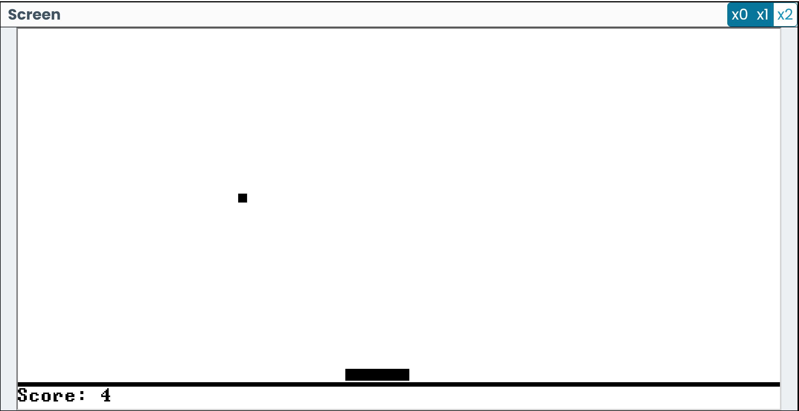

# Computing Platform — From Hardware to Compiler

[](https://github.com/yawamomensah/nand2tetris/actions/workflows/jack-tests.yml)

A computing platform implemented from the ground up in HDL and C, spanning digital logic, computer architecture, an assembler, a VM translator, and a Jack compiler.

I chose the Nand2Tetris curriculum as the project framework because its supplied test suites and tools provide third-party, objective verification of my implementations. The curriculum supplies the sequence, fixtures, and reference tools; the focus here is on the implementations and how their layers work together.

## What Was Built

| Layer | Implementation | Language |
|---|---|---|
| Boolean Logic Gates | NAND, AND, OR, NOT, XOR, MUX, DMUX and all variants | HDL |
| Combinational Chips | Half adder, full adder, ALU, multiplexers | HDL |
| Sequential Chips | D flip-flop, registers, RAM8 through RAM16K, PC | HDL |
| CPU | Complete Hack CPU with A/D registers, ALU, PC | HDL |
| Memory | ROM, RAM, Screen, Keyboard mapped memory | HDL |
| Assembler | Two-pass assembler with symbol resolution | C |
| VM Translator | Stack-based bytecode to assembly translator | C |
| Jack Tokenizer | Lexical analyser — source text to typed token stream | C |
| Jack Parser | Recursive descent parser with XML parse tree output | C |
| Jack Compiler | Full code generation — Jack source to VM bytecode | C |

## Automated Tests & Toolchain Verification

GitHub Actions runs the native test workflow on pushes, pull requests, and manual dispatches. The workflow installs the official Nand2Tetris tools, verifies the downloaded archive with a SHA-256 checksum, fetches the official course fixtures at a pinned revision, builds the C programs, and runs these checks:

- **Assembler and VM translators:** The assembler translates `Mult.asm`, which is run in the CPU Emulator and checked against the expected result. The VM translators are tested on stack arithmetic, memory access, program flow, and function-call fixtures, including multi-file directory translation. Generated assembly is executed in the CPU Emulator and compared with expected results.
- **HDL hardware:** HDL implementations are tested in the Hardware Simulator against the supplied test scripts and comparison files for the logic and arithmetic hardware.
- **Jack tokenizer and parser:** Tokenizer and parser outputs for the parser fixtures are compared with the supplied expected XML files.
- **Jack compiler:** The compiler is built and run on the sample programs `Average`, `ComplexArrays`, `ConvertToBin`, `Pong`, `Seven`, and `Square`. These are compile checks; the workflow does not claim to have dedicated expected-output test files for every compiler program. It additionally runs compiled `Seven` in the VM Emulator with the course OS and checks its output.

The screenshot below is separate end-to-end evidence: Pong is running in the Hack emulator, demonstrating the compiler, VM translator, assembler, CPU, and screen output working together.



---

## The Intellectual Arc

What became clear building each layer is that **constraints are not obstacles to elegant solutions — they are the source of them**. The Hack architecture's minimal instruction set forces you to understand abstractions at a much deeper level. You do not just assemble instructions; you have to reason about the machine model itself.

This isn't something you understand by reading about it. It becomes visible when you implement it.

---

## Assembler — C Implementation

A two-pass assembler that translates Hack assembly into binary machine code.

**First pass** — scans the source file building a symbol table of label declarations and their ROM addresses using a custom djb2 hash table with chaining.

**Second pass** — translates each instruction, resolving symbols through the table built in the first pass. A-instructions become 16-bit values, C-instructions are encoded by decomposing their destination, computation, and jump fields into the correct bit patterns.

**Infrastructure built from scratch:**
- djb2 hash table with chaining for O(1) symbol lookup
- Two-pass parser with clean separation between symbol resolution and instruction translation
- Fail fast error handling — invalid instructions exit immediately with meaningful messages

---

## VM Translator — C Implementation

A complete VM translator covering the Hack VM specification. It translates stack-based bytecode into Hack assembly and implements the virtual machine's execution model from the ground up, including arithmetic, memory access, branching, and function calls.

### Pipeline Architecture

```
raw line → strip → tokenize → lookup → dispatch → codewriter → .asm output
```

Each stage has a single responsibility and a clean contract with the next. New VM commands are added to the lookup table and code writer without disturbing the surrounding architecture.

### Custom Infrastructure

**String library** — hand-written string utilities including `strip` (in-place whitespace and comment removal via `memmove`) and a custom tokenizer using an anchor/scout two-pointer strategy with a small static vocabulary table.

**Hash table** — djb2 hash table (size 31, chaining) over a static `CommandEntry` ground truth table covering the VM command set. The hash table holds type, operation, and code generation metadata for the translator.

**`string_to_int`** — custom integer parser with overflow detection against Hack's 16-bit bounds using `HACK_INT_MAX` and `HACK_INT_MIN` macros, trailing character validation, and preserved input state. It rejects malformed numeric literals before they can corrupt generated assembly.

### Arithmetic, Logic, and Memory Access

Implements arithmetic, logical, comparison, and memory access commands across all eight virtual memory segments:

- **Binary operations** — `add`, `sub`, `and`, `or` via parameterised `write_binary`, substituting only the ALU instruction string
- **Unary operations** — `neg`, `not` via `write_unary`
- **Comparison operations** — `eq`, `gt`, `lt` with unique label generation via caller-owned counter passed as `int*`, producing `FunctionName$ret.i` symbols that avoid collisions in the flat assembly output
- **Memory segments** — `constant`, `static`, `local`, `argument`, `this`, `that`, `temp`, `pointer` — each with distinct address computation patterns. `static` uses `Filename.i` symbols resolved at translation time

### Functions and Calling Convention

Implements a complete runtime environment for function calls — the mechanism that makes arbitrarily nested function execution possible on a flat stack machine.

**`write_function`** — emits the function entry label followed by a local variable initialisation loop, pushing 0 onto the stack `n_locals` times.

**`write_call`** — complete frame setup sequence:
1. Push return address symbol (`CurrentFunction$ret.i`) — loads ROM address of the label into D via `D=A`
2. Push saved LCL, ARG, THIS, THAT — loads pointer values via `D=M`
3. Reposition ARG to `SP - nArgs - 5` — reaches back past the five saved values to the first argument
4. Reposition LCL to current SP — callee's local segment starts here
5. Jump to callee entry label
6. Emit return address label — the instruction immediately following, where execution resumes after return

**`write_return`** — frame dismantling sequence:
1. Save frame base (`LCL`) to R13 before anything moves
2. Save return address (`*(LCL-5)`) to R14 — must happen before SP is repositioned
3. Reposition return value to `*ARG` — caller expects it here
4. Restore SP to `ARG + 1`
5. Restore THAT, THIS, ARG, LCL from frame offsets in reverse order — LCL last since all offsets are computed relative to it
6. Jump via R14 to saved return address

**Symbol generation** follows the VM specification naming convention:
- Function entry points: `FunctionName` (e.g. `Foo.bar`)
- Branching labels: `FunctionName$label` (e.g. `Foo.bar$LOOP`)
- Return address symbols: `FunctionName$ret.i` (e.g. `Foo.bar$ret.0`)
- Static variables: `Filename.i` (e.g. `Foo.3`)

**Directory translation mode** — when passed a directory, the translator processes all `.vm` files into a single output assembly file, emitting bootstrap code (SP initialisation + `call Sys.init`) and preserving the correct function call structure across the entire program.

### Error Handling Philosophy

Fail fast throughout. Unrecognised commands, malformed input, invalid segment indices, integer overflow, truncated lines — all caught at the earliest possible point with meaningful `stderr` messages and non-zero exit codes.

### Code Review

Both VM translator implementations were reviewed by CodeRabbit:
- **Complexity rating: 4 (Complex)**
- Estimated review effort: ~50 minutes per implementation
- Issues found: targeted mechanical findings, no architectural concerns raised

---

## Jack Compiler — C Implementation

A complete compiler for the Jack language, implemented in C. It includes a front end for lexical analysis and parsing, plus symbol resolution and code generation.

### Pipeline

```
.jack source → tokenizer → token stream → parser → parse tree + VM code
```

The tokenizer and parser are strictly separated. The tokenizer's only job is to produce a flat, typed token stream from source text. The parser's only job is to impose grammatical structure on that stream and emit VM instructions as it walks the parse tree.

### Tokenizer

The tokenizer consumes a Jack source file and produces a flat array of typed tokens, each represented as a slice into the original source buffer — a pointer and length with no allocation or copy for each token.

**Character classification** is handled by a dispatch table indexed on the first character of each token, collapsing the branching that would otherwise dominate the recognition loop into a single, cache-friendly decision tree.

**Keyword discrimination** happens at the identifier boundary: candidates that pass the identifier character test are submitted to a `bsearch` against a sorted keywords array. Identifiers that match keywords are promoted to their keyword token type; otherwise they remain identifiers.

**Token storage** uses a flat array of structs with dynamic doubling reallocation — no pool allocator, no array of heap pointers. The layout is cache-friendly and the growth strategy is the standard geometric expansion that keeps the scan loop fast and predictable.

**The two-pointer anchor/scout idiom** drives the main scan loop, with the anchor always positioned at the first character of the next token and the scout advancing to find its boundary. Precondition checks minimise the cost of moving across whitespace and symbols while preserving correctness.

### Parser

A hand-written recursive descent parser structured directly from the Jack grammar. Each non-terminal in the grammar maps to a function; each function consumes exactly the tokens its production requires and returns the VM code it generates.

**Error handling** follows the same fail-fast discipline as the rest of the pipeline. A token that does not match the expected terminal exits immediately with the offending token, its position, and a clear diagnostic to help localize the grammar error.

### Symbol Table

Two-scope flat array model: `ClassTable` (field/static) and `SubTable` (argument/local), each a fixed array of entry structs with slice-based name and type fields — pointer and length into the original source buffer for names, and a compact kind/type encoding for variables.

Both lookup functions iterate from the most recently inserted entry backwards — variables declared closest to the point of use are found first on average, reducing comparisons in the common case without introducing a heavier hash table for a language whose symbol tables stay small and local.

Linear search over the flat array is deliberate — Jack's scope sizes make hashing unnecessary overhead. A subroutine symbol table large enough to require hashing would indicate a poorly structured program rather than a true need for a more complex data structure.

### Code Generation

**Subroutine kind handling** — the subroutine kind (constructor/method/function) is captured into `ParserState` before parsing the keyword. The `function` declaration is deferred until all `var` declarations have been processed, then emitted in the correct position in the class output.

- Constructor: `push field_count`, `call Memory.alloc 1`, `pop pointer 0`
- Method: `push argument 0`, `pop pointer 0`
- Function: no preamble

For methods, a hidden `this` entry is inserted into the subroutine table before parameter parsing so explicit parameters receive correct indices from 1.

**Expression code generation** — `compileExpression` holds the binary operator in a temporary after consuming it, compiles the right-hand term, then emits the operator. Postfix ordering falls out naturally from the recursive descent structure and the generated VM stack discipline.

**`compileTerm`** handles all term forms: integer and string constants, keyword constants (`null`/`false` → `push constant 0`; `true` → `push constant 0` / `not`; `this` → `push pointer 0`), unary operators, array indexing, subroutine calls, and parenthesized expressions.

**Array assignment** uses a temp register to preserve the RHS value across the `pointer 1` assignment: push base address, compile index, `add`, compile RHS, `pop temp 0`, `pop pointer 1`, `push temp 0`, `pop that 0`.

**Label generation** — `compileIf` and `compileWhile` each reserve two indices from a persistent `label_count` in `ParserState` at function entry, before any recursive `compileStatements` call. This keeps all generated labels in the same namespace and avoids label collisions when nested control flow appears.

**Void return** — `compileReturn` pushes `constant 0` before emitting `return` when the next token is `;`. `compileDo` pops the discarded return value into `temp 0` after every subroutine call to maintain the stack discipline required by the VM.

**`emit_push` / `emit_pop`** centralise the kind-to-segment mapping: `T_STATIC` → `static`, `T_FIELD` → `this`, `T_ARG` → `argument`, `T_VAR` → `local`.

### Code Review

The compiler implementation was reviewed by CodeRabbit:
- **Complexity rating: 4 (Complex)**
- Estimated review effort: ~50 minutes
- Issues found: targeted mechanical findings, no architectural concerns raised

---

## Repository Structure

```
nand2tetris/
├── part_I/
│   ├── chapter_01/     — Boolean Logic
│   ├── chapter_02/     — Boolean Arithmetic
│   ├── chapter_03/     — Sequential Logic
│   ├── chapter_04/     — Machine Language
│   ├── chapter_05/     — Computer Architecture
│   └── chapter_06/     — Assembler (C)
└── part_II/
    ├── chapter_07/     — VM Translator Part I (C)
    ├── chapter_08/     — VM Translator Part II (C)
    ├── chapter_10/     — Jack Tokenizer and Parser (C)
    └── chapter_11/     — Jack Compiler Back-End (C)
```

## References

- Nisan & Schocken — *The Elements of Computing Systems* (Nand2Tetris)
- Bryant & O'Hallaron — *Computer Systems: A Programmer's Perspective* (CS:APP)
- Kernighan & Ritchie — *The C Programming Language* (K&R 2nd edition)
- Petzold — *Code: The Hidden Language of Computer Hardware and Software*
